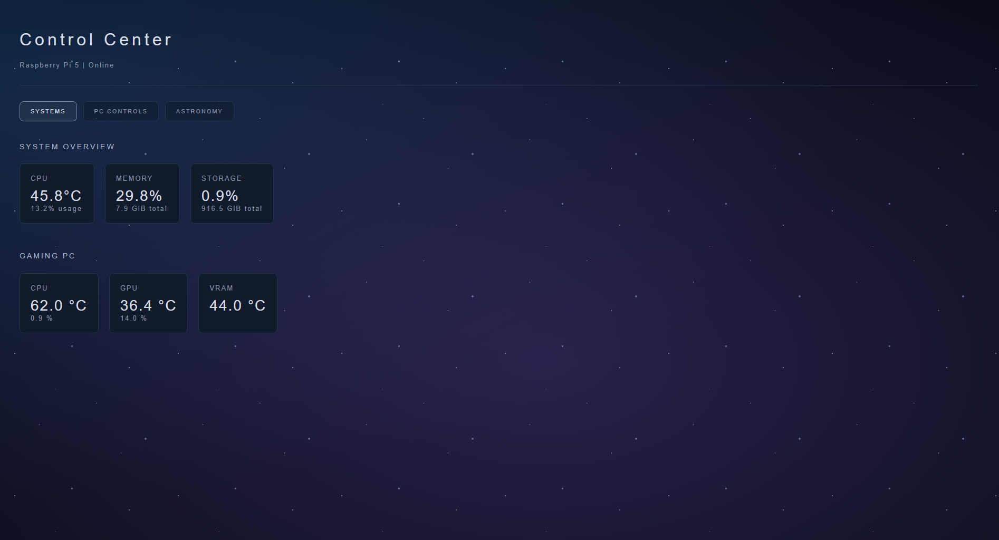

# Raspberry Pi 5 Control Center

## Dashboard Preview 

## Project Overview

A custom Raspberry Pi 5 dashboard designed to monitor system performance, display live telemetry from a Windows gaming PC, and eventually serve as a touchscreen control center for my home network.

This is an ongoing personal project focused on learning Linux, Python, networking, remote system administration, and Git.

## Current Features

- Live Raspberry Pi CPU temperature and usage monitoring
- Raspberry Pi memory and storage statistics
- Windows gaming PC CPU and GPU telemetry integration
- Custom HTML, CSS, and JavaScript dashboard
- Astronomy-inspired starfield interface
- Multiple dashboard pages for future expansion
- Remote development using SSH and Visual Studio Code

## Hardware

- Raspberry Pi 5
- NVMe SSD for additional storage and running Raspberry Pi OS
- Windows gaming PC
- Ethernet network connection

## Technologies Used

- **Linux / Raspberry Pi OS** — Operating system and server environment
- **Python** — Backend server and system monitoring
- **HTML** — Dashboard structure
- **CSS** — Visual styling and starfield design
- **JavaScript** — Live data updates and dashboard navigation
- **SSH** — Remote access and administration
- **Git** — Version control
- **GitHub** — Project hosting and documentation (publication in progress)

## Security Considerations

- The Python dashboard server listens on the Raspberry Pi's localhost interface.
- The Windows telemetry password is read from an environment variable rather than hardcoded into the Python source.
- A `.gitignore` file excludes common secret files, temporary files, and manual backups.

### Planned Security Improvements

- Move the Windows telemetry server address into local configuration.
- Improve encryption and authentication for communication between the Raspberry Pi and Windows PC.
- Review network exposure and access controls.
- Add automated secret scanning before publishing future changes.

## Planned Features

- Touchscreen-friendly controls for the Windows gaming PC
- Dedicated astronomy dashboard with space imagery
- Homelab and network monitoring
- Additional system performance information
- Ambient display mode
- Improved dashboard navigation and customization

## Project Status

**Active Development**

This project is being developed as a hands-on learning experience while working toward a career in information technology. Development includes AI-assisted guidance, independent troubleshooting, and learning the underlying technologies.

Future updates and improvements will be documented through Git.