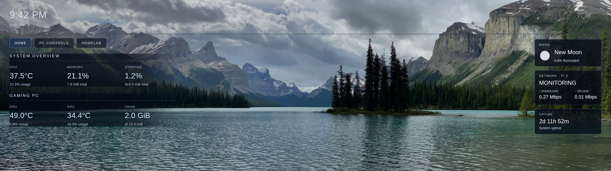

# Raspberry Pi 5 Control Center

A custom-built Raspberry Pi 5 dashboard combining real-time system monitoring, Windows gaming PC telemetry, and an astronomy-inspired touchscreen interface.

## Dashboard Preview



## Project Overview

The goal of this project is to transform a Raspberry Pi 5 into a dedicated touchscreen control center for monitoring computers, managing devices, and eventually overseeing a home network and homelab.

This project is also a hands-on learning experience focused on Linux, Python, networking, web development, troubleshooting, and Git.

## Current Features

- Live Raspberry Pi CPU temperature and usage monitoring
- Raspberry Pi memory, storage, and uptime statistics
- Windows gaming PC CPU and GPU telemetry using LibreHardwareMonitor
- Moon phase and illumination information
- Custom astronomy-inspired interface with animated stars
- Navigation sections for Home, PC Controls, Astronomy, and Homelab
- Touchscreen-oriented ultrawide layout
- Environment-based configuration for Windows telemetry credentials

## Hardware

- Raspberry Pi 5 (8 GB RAM)
- NVMe SSD running Raspberry Pi OS
- 12.3-inch ultrawide touchscreen (2560 × 720)
- Windows gaming PC
- Local home network

## Technology Stack

| Technology | Purpose |
|---|---|
| Python | Backend HTTP server and system monitoring |
| psutil | Raspberry Pi system statistics |
| Skyfield | Astronomy calculations |
| HTML | Dashboard structure |
| CSS | Interface styling |
| JavaScript | Live data updates and navigation |
| LibreHardwareMonitor | Windows PC hardware telemetry |
| SSH | Remote Linux administration |
| Git & GitHub | Version control and documentation |
| Raspberry Pi OS | Linux operating environment |

## Architecture

The Raspberry Pi hosts the dashboard and collects its own system statistics locally.

A Python backend retrieves Windows gaming PC telemetry from LibreHardwareMonitor over the local network and provides selected statistics to the dashboard frontend.

JavaScript requests updated information from the backend and displays it in the custom interface.

## Installation & Setup

### Requirements

- Raspberry Pi running Raspberry Pi OS
- Python 3.13 and pip
- Git
- Optional: Windows gaming PC running LibreHardwareMonitor

### 1. Clone the Repository

```bash
git clone https://github.com/JustinC711/raspberry-pi-control-center.git
cd raspberry-pi-control-center
```

### 2. Create a Virtual Environment

```bash
python3 -m venv .venv
source .venv/bin/activate
```

### 3. Install Dependencies

```bash
python -m pip install -r requirements.txt
```

### 4. Configure Windows Telemetry (Optional)

The backend uses these environment variables:

```env
PC_MONITOR_URL=http://YOUR_PC_IP:8085
PC_MONITOR_PASSWORD=YOUR_PASSWORD
```

Store configuration in a local `.env` file and never commit credentials to GitHub.

Windows telemetry requires LibreHardwareMonitor's HTTP server and appropriate local firewall permissions.

### 5. Start the Dashboard

```bash
python server.py
```

Open the dashboard locally on the Raspberry Pi:

```text
http://127.0.0.1:8000
```

**Note:** The astronomy feature may require a local `de421.bsp` ephemeris file, which is not included in this repository. Setup instructions for this data file are still being finalized.

## Security Considerations

- The dashboard server binds to `127.0.0.1` by default.
- Windows telemetry credentials are loaded from local configuration rather than hardcoded into source files.
- `.gitignore` excludes sensitive configuration, virtual environments, and backup files.
- SSH key authentication and firewall rules restrict remote access.
- Git history has been scanned for accidentally committed secrets.
- The dashboard is intended for local use, not direct public internet exposure.

## Planned Features

- Interactive Windows PC controls
- Expanded astronomy dashboard
- Homelab and network monitoring
- Touchscreen navigation improvements
- Ambient display mode
- Improved telemetry reliability and configuration documentation
- Encrypted communication between devices

## Project Status

**Active Development**

This project is being developed as a hands-on learning experience while preparing for a career in information technology.

Development includes AI-assisted guidance, hands-on implementation, independent troubleshooting, and learning the underlying technologies.
